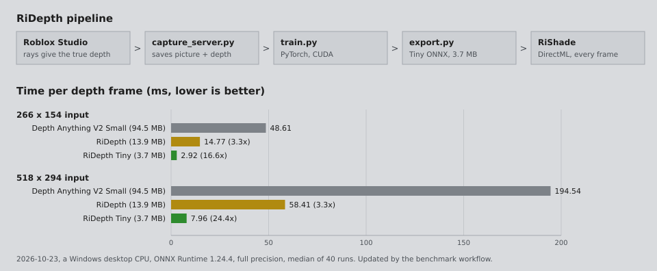
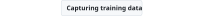
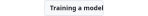
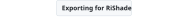
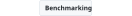
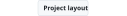

<h1 align="center"><b>RiDepth</b></h1>

<p align="center">
  A tiny depth model made for Roblox, trained on exact depth from Roblox Studio.
</p>

<p align="center">
  <picture><source media="(prefers-color-scheme: dark)" srcset="assets/benchmark-dark.svg"></picture>
</p>

<p align="center">
  <a href="#capturing-training-data">Get started</a> |
  <a href="https://github.com/KloBraticc/Voidstrap">Voidstrap</a> |
  <a href="docs">Docs</a> |
  <a href="LICENSE">License</a>
</p>

<div align="center">

[![License][shield-license-flat]][link-license]
[![Stars][shield-repo-stars]][repo-stargazers]
[![Last commit][shield-last-commit]][repo-commits]

</div>

<h5 align="center">
  Leave a star if you like the project! ⭐️
</h5>

<p align="center">
  <picture><source media="(prefers-color-scheme: dark)" srcset="assets/readme/windows-tile-dark.svg"></picture>
</p>

---

> [!NOTE]
> RiDepth is the depth model behind RiShade in [Voidstrap](https://github.com/KloBraticc/Voidstrap). General depth models are trained on photos, so on Roblox they blur edges, put the sky at the wrong distance and leave ghosts in reflections. RiDepth only ever sees Roblox, and it learns from depth that Studio measures exactly, not from guesses.

The chart above is rebuilt by GitHub Actions from a fresh benchmark run, so the numbers are always real. It runs on a plain CPU runner, where everything is much slower than on a GPU. On an RTX 3060 Ti through DirectML, RiDepth Tiny takes about 0.7 ms per frame at 266 px and 1 ms at 518 px.

## Features

- **Exact training data**: a Studio plugin casts a ray for every pixel, so each sample has true depth and true surface direction
- **Two outputs**: depth for every effect, and surface normals that reflections can use directly instead of guessing them from depth
- **Sky at the far plane**: open sky is learned as infinitely far, so reflections never smear into it
- **Tiny and fast**: RiDepth Tiny is under 1 million parameters and about 2 MB in half precision
- **Distillation**: Tiny learns from the larger RiDepth model as well as from the true depth, so it keeps most of the quality
- **Drop in ONNX**: the export matches what RiShade loads, with dynamic width and height
- **Runs on any DirectX 12 GPU** through DirectML in RiShade, NVIDIA, AMD and Intel alike
- **Live benchmark** against Depth Anything V2 Small, refreshed by a scheduled workflow

## Usage

<details>
  <summary><picture><source media="(prefers-color-scheme: dark)" srcset="assets/readme/capture-dark.svg"></picture><picture></picture></summary>

You need Python 3.11 and Roblox Studio on Windows.

```bash
python -m venv .venv
.venv\Scripts\python -m pip install -r requirements.txt
```

Start the capture server and leave it running:

```bash
.venv\Scripts\python tools\capture_server.py
```

Copy `studio/RiDepthCapture.lua` into `%LOCALAPPDATA%\Roblox\Plugins`, restart Studio and open a place. Click **Plugins**, **RiDepth**, **Capture** and allow HTTP requests when Studio asks. The camera visits 400 random spots and every sample lands in `data/`.

Keep Studio in front while it runs. The server pauses on its own when another window covers it, and the plugin hides the place's own UI so it never ends up in the pictures. Capture in many different places, variety matters more than sample count.

More detail is in [docs/capture.md](docs/capture.md).

</details>

<details>
  <summary><picture><source media="(prefers-color-scheme: dark)" srcset="assets/readme/training-dark.svg"></picture><picture></picture></summary>

Training needs an NVIDIA GPU. Install the CUDA build of PyTorch first:

```bash
.venv\Scripts\python -m pip install torch torchvision --index-url https://download.pytorch.org/whl/cu124
```

Train the full model, then the tiny one with the full model as its teacher:

```bash
.venv\Scripts\python train.py
.venv\Scripts\python train.py --variant tiny --teacher runs\best.pt --runs runs\tiny --epochs 80 --batch 16
```

| Option | What it does |
| --- | --- |
| `--variant` | `base` or `tiny` |
| `--teacher` | Weights of a trained `base` model to learn from |
| `--epochs` | Passes over the data, 60 by default |
| `--batch` | Images per step, lower it if the GPU runs out of memory |
| `--resume` | Continue from saved weights |

The best weights are kept in `runs\best.pt`. More detail is in [docs/training.md](docs/training.md).

</details>

<details>
  <summary><picture><source media="(prefers-color-scheme: dark)" srcset="assets/readme/export-dark.svg"></picture><picture></picture></summary>

```bash
.venv\Scripts\python export.py --variant tiny --weights runs\tiny\best.pt --output exports\ridepth-tiny.onnx --fp16
```

The exporter checks the model at 266 and 518 pixels before it finishes.

| | |
| --- | --- |
| Input | `pixel_values`, `[1, 3, height, width]`, ImageNet normalised RGB |
| Outputs | `predicted_depth` `[1, height, width]` (higher is closer, sky is 0) and `normals` `[1, 3, height, width]` in camera space |
| Dynamic axes | `batch_size`, `height`, `width` |

The full format is described in [docs/model-format.md](docs/model-format.md).

</details>

<details>
  <summary><picture><source media="(prefers-color-scheme: dark)" srcset="assets/readme/benchmark-dark.svg"></picture><picture></picture></summary>

Time any ONNX depth model on your own GPU through DirectML, the same way RiShade runs it:

```bash
.venv\Scripts\python -m pip install onnxruntime-directml
.venv\Scripts\python tools\benchmark.py exports\ridepth-tiny.onnx --sizes 266 392 518
```

Rebuild the README chart locally:

```bash
.venv\Scripts\python -m tools.render_benchmark --device "my PC"
```

Model speed does not depend on trained weights, so the chart uses freshly built models and never needs the training data.

</details>

<details>
  <summary><picture><source media="(prefers-color-scheme: dark)" srcset="assets/readme/layout-dark.svg"></picture><picture></picture></summary>

| Path | What it is |
| --- | --- |
| `studio/RiDepthCapture.lua` | Studio plugin that moves the camera and ray traces depth and normals |
| `tools/capture_server.py` | Local server on `127.0.0.1:8765` that takes the screenshots and saves samples |
| `ridepth/model.py` | `RiDepthNet` (MobileNetV3 Large) and `RiDepthTiny` (MobileNetV3 Small) |
| `ridepth/losses.py` | Scale invariant depth, gradient and normal losses |
| `train.py` | Training with optional distillation |
| `export.py` | ONNX export with shape checks |
| `tools/benchmark.py` | DirectML or CPU timing |
| `tools/render_benchmark.py` | Builds the chart at the top of this page |

</details>

## Built With

[![Python][shield-python]][link-python] [![PyTorch][shield-pytorch]][link-pytorch] [![ONNX][shield-onnx]][link-onnx] [![Luau][shield-luau]][link-luau]

## License

[![License][shield-license]][link-license]

RiDepth is released under the [MIT License](LICENSE). The encoders start from torchvision's ImageNet MobileNetV3 weights (BSD 3 Clause). The benchmark downloads Depth Anything V2 Small (Apache 2.0) from Hugging Face to compare against, it is never included in this repository. The Windows icon is from [Voidstrap](https://github.com/KloBraticc/Voidstrap).

[shield-license]:      https://img.shields.io/github/license/KloBraticc/RiDepth?style=for-the-badge
[shield-license-flat]: https://img.shields.io/github/license/KloBraticc/RiDepth?style=flat&color=4c1
[shield-repo-stars]:   https://img.shields.io/github/stars/KloBraticc/RiDepth?style=flat&color=ffd700&label=stars
[shield-last-commit]:  https://img.shields.io/github/last-commit/KloBraticc/RiDepth?style=flat&color=8a2be2
[shield-python]:       https://img.shields.io/badge/Python-3776AB?style=for-the-badge&logo=python&logoColor=white
[shield-pytorch]:      https://img.shields.io/badge/PyTorch-EE4C2C?style=for-the-badge&logo=pytorch&logoColor=white
[shield-onnx]:         https://img.shields.io/badge/ONNX-005CED?style=for-the-badge&logo=onnx&logoColor=white
[shield-luau]:         https://img.shields.io/badge/Luau-00A2FF?style=for-the-badge

[link-license]:        https://github.com/KloBraticc/RiDepth/blob/main/LICENSE
[repo-stargazers]:     https://github.com/KloBraticc/RiDepth/stargazers
[repo-commits]:        https://github.com/KloBraticc/RiDepth/commits/main
[link-python]:         https://www.python.org/
[link-pytorch]:        https://pytorch.org/
[link-onnx]:           https://onnx.ai/
[link-luau]:           https://luau.org/
